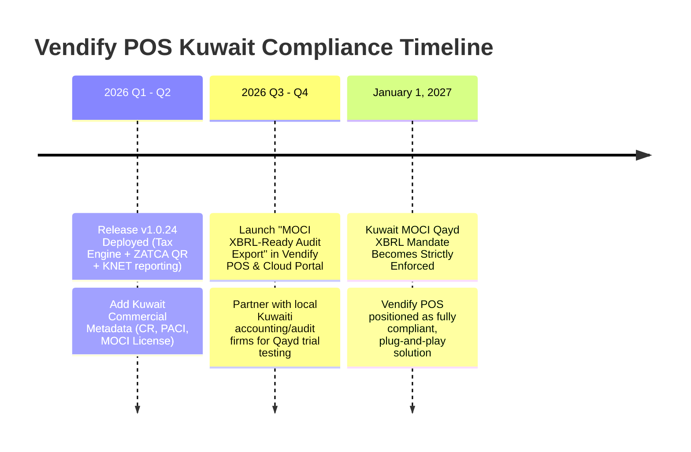

# Kuwait 2027 Regulatory Mandate: XBRL (MOCI Qayd) & Tax/VAT Compliance Guide

> [!IMPORTANT]
> **Executive Summary for Vendify POS:**
> * **The January 1, 2027 Deadline:** The Kuwait Ministry of Commerce and Industry (MOCI) has officially mandated that starting **January 1, 2027**, **all registered commercial entities in Kuwait** (W.L.L., Single-Person Companies, Shareholding, General Partnerships) must file their financial statements electronically using **XBRL (eXtensible Business Reporting Language)** via the newly launched **Qayd Portal (`qayd.moci.gov.kw`)**. Traditional paper and unformatted PDF filings will be strictly rejected.
> * **XBRL vs. VAT Distinction:** **XBRL is not a tax rate**; it is a global digital data standard (XML-based semantic tagging) used for statutory financial reporting and auditing. Concurrently, Kuwait is advancing its **Tax Reforms** (the 5% GCC Unified VAT agreement and broader Corporate/Business Profits Tax).
> * **Vendify POS Position:** By structuring our POS data models, general ledger tagging, and reporting modules now, Vendify POS will become the **first retail POS platform in Kuwait to offer native "XBRL-Ready" financial exports**, giving merchants and their certified auditors an effortless compliance bridge.

---

## 1. What is XBRL & The Kuwait MOCI "Qayd" System?


### 1.1 The Qayd Platform (منصة قيد)
* **Governing Body:** Ministry of Commerce and Industry (MOCI), in close coordination with the Kuwaiti Association of Accountants and Auditors.
* **Authentication:** Secured via **Kuwait Mobile ID (تطبيق هويتي)** for both corporate managers and licensed statutory auditors.
* **Format Standard:** **XBRL (eXtensible Business Reporting Language)** based on standard IFRS (International Financial Reporting Standards) and IFRS for SMEs, adapted to Kuwaiti Commercial Companies Law.
* **Implementation Timeline:**
  * **2025:** Kuwait Capital Markets Authority (CMA) implemented XBRL disclosures (*iFSAH*) for listed companies.
  * **April 2026:** MOCI launched Phase 1 (Voluntary / Pilot phase of the Qayd platform).
  * **January 1, 2027:** **Mandatory enforcement** for 100% of registered Kuwaiti business entities.

---

## 2. Kuwait Tax & VAT Framework (2025 – 2027)

Alongside the financial XBRL mandate, Kuwait is modernizing its tax architecture:

| Tax / Regulation | Current Status | Target Window | Impact on Retail & POS |
| :--- | :--- | :--- | :--- |
| **GCC Unified VAT (5%)** | Drafted / Under Parliamentary Review | 2026 – 2027 | 5% standard rate on retail goods/services. Requires itemized tax on receipts, TRN, and QR code. |
| **Domestic Minimum Top-up Tax (DMTT / Pillar 2)** | Enacted (1 Jan 2025) | Active | 15% minimum tax on multinational groups with revenue ≥ EUR 750M. |
| **Business Profits Tax (BPT)** | Legislative Draft | Projected 2026–2027 | Broadens corporate income tax to domestic corporate profits beyond the traditional 15% foreign corporate tax. |
| **E-Invoicing Standard** | Pilot evaluations | Expected alongside VAT | GCC/ZATCA-style Phase 1 (TLV QR codes on thermal/PDF slips) and Phase 2 (API e-invoice clearance). |

---

## 3. How POS Data Connects to XBRL

A Point of Sale system does not send an individual XBRL file per receipt. Instead, **POS transactions are the bedrock of the financial statement**. If the POS does not capture and isolate transaction data properly, an auditor cannot generate a compliant XBRL report without painful manual data reconstruction.

### Mapped Financial Concepts:

```
┌────────────────────────────────────────────────────────┬────────────────────────────────────────────────────────┐
│ Vendify POS Transaction Element                        │ Kuwait MOCI / IFRS XBRL Taxonomy Tag                   │
├────────────────────────────────────────────────────────┼────────────────────────────────────────────────────────┤
│ Total Product Sales (Gross)                            │ `RevenueFromSaleOfGoods`                               │
│ Line Item & Cart Discounts                             │ `DiscountsAndRebates`                                  │
│ Customer Returns & Cash Refunds                        │ `ReturnsAndAllowances`                                 │
│ Net Sales                                              │ `NetRevenue`                                           │
│ Cost of Goods Sold (from Shopify Cost/Item)            │ `CostOfSales`                                          │
│ Gross Profit margin                                    │ `GrossProfit`                                          │
│ VAT / Tax Collected                                    │ `ValueAddedTaxPayable` / `OtherOperatingTaxes`         │
│ KNET Settlements Receivable                            │ `TradeAndOtherReceivables`                             │
│ Cash in Register / Drawer                              │ `CashOnHand`                                           │
│ Closing Stock Value                                    │ `Inventories`                                          │
└────────────────────────────────────────────────────────┴────────────────────────────────────────────────────────┘
```

---

## 4. How We Prepare Vendify POS for the Kuwait Market

To make Vendify POS the preferred choice for Kuwaiti merchants, we will implement the following features ahead of the 2027 deadline:

### Feature 1: Kuwait Commercial Identity Metadata
In POS & Cloud Settings:
* **Kuwait Commercial Registry (CR) Number (رقم السجل التجاري)**
* **MOCI License Number (رقم ترخيص وزارة التجارة والصناعة)**
* **PACI / Civil ID Number (الرقم المدني للمنشأة)**
* **Display on Receipts:** Optional inclusion of CR and PACI on customer thermal and PDF slips.

### Feature 2: Native "MOCI / XBRL Financial Audit Export"
In `features/reports`:
* Add a dedicated **"Kuwait MOCI Audit Export (XBRL-Ready)"** button.
* Generates a structured JSON/CSV export formatted strictly according to the MOCI Financial Taxonomy accounts:
  * Daily/Monthly Breakdown of Gross Sales, Discounts, Refunds, Net Sales, Tax, COGS, and Gross Margin.
  * Tender breakdown (KNET vs. Cash vs. Visa/Mastercard).
* **Auditor Friendly:** Licensed Kuwaiti auditors can upload or import this file directly into their XBRL instance generation software without manual bookkeeping.

### Feature 3: Full KNET Reconciliation & Settlement Logging
* Since KNET accounts for over 80% of retail card payments in Kuwait, distinct KNET settlement matching is critical for the "Cash & Bank Balance" XBRL balance sheet tag.
* Vendify POS already segments KNET in payment tenders and the dual-store X-Out report.

### Feature 4: E-Invoicing & ZATCA-Style QR Codes (Already Implemented in v1.0.24!)
* Kuwait's Ministry of Finance has confirmed that its eventual e-invoicing architecture will align with GCC peers (Saudi ZATCA and UAE FTA).
* Because Vendify POS v1.0.24 already features **ZATCA / GCC Compliant TLV Base64 QR code generation**, merchants using Vendify POS are already ahead of the curve.

---

## 5. Strategic Roadmap & Timeline


